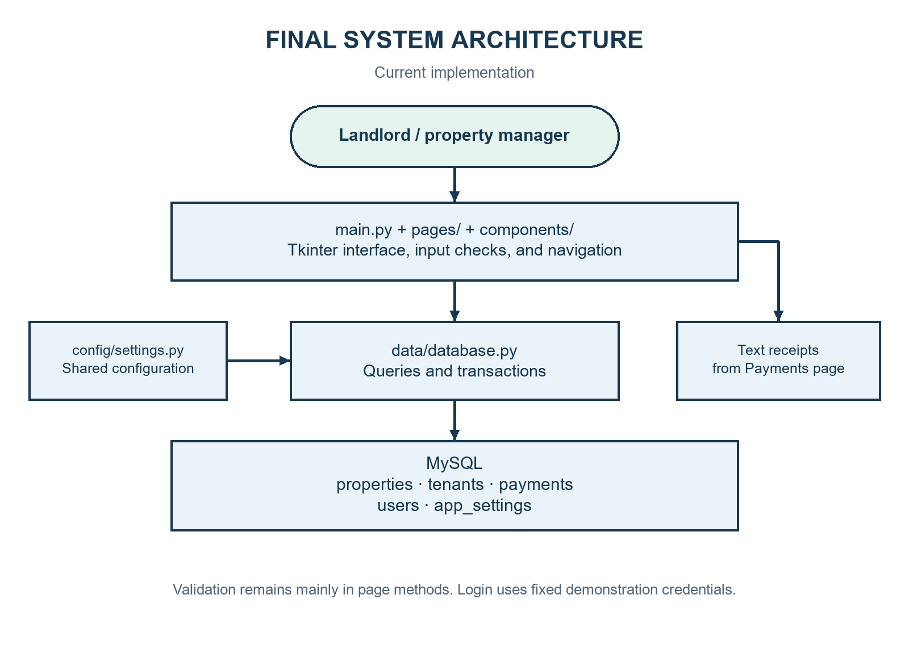
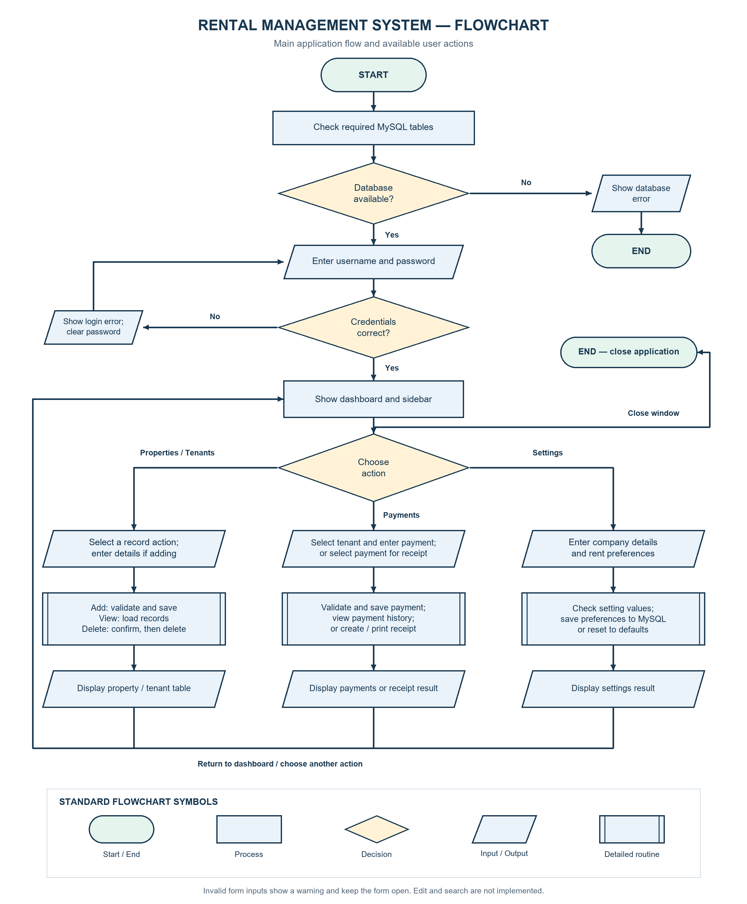
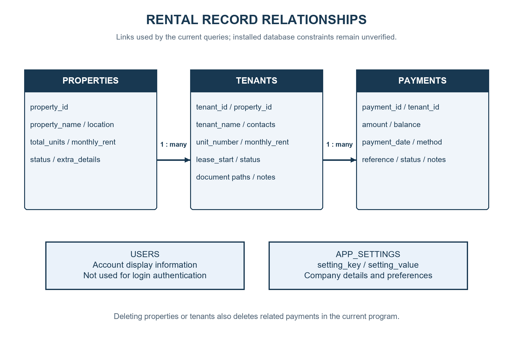
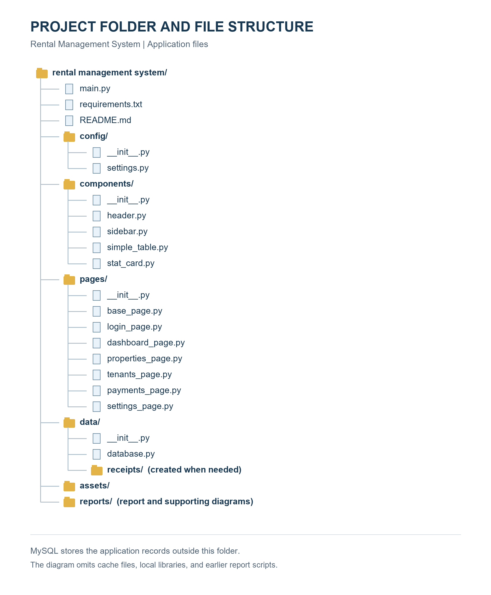
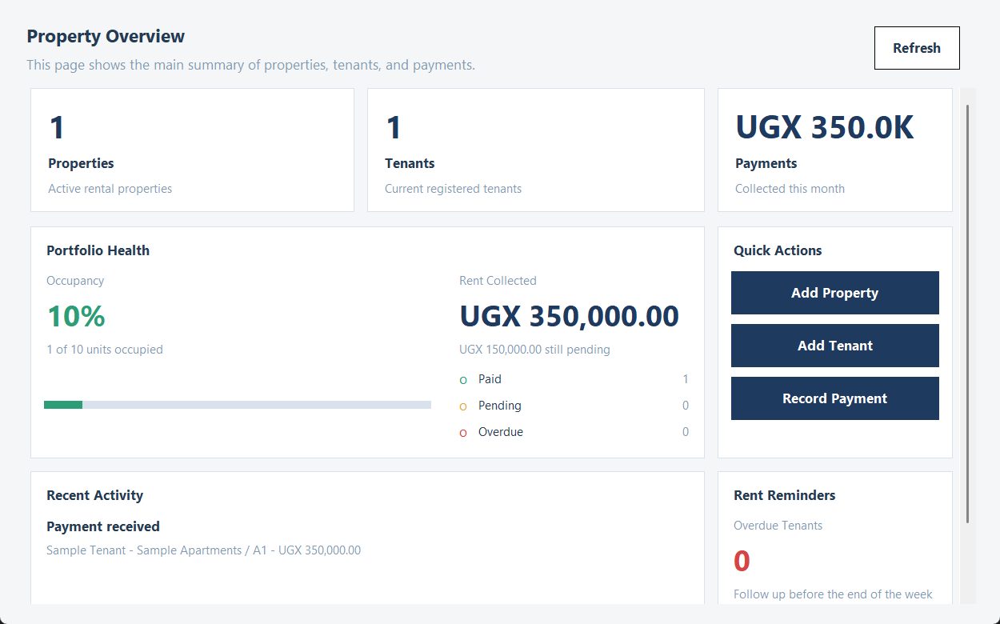
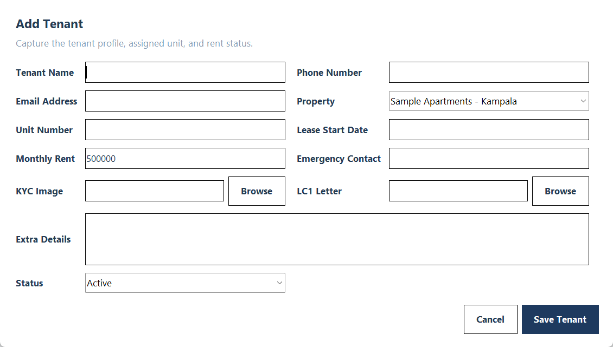
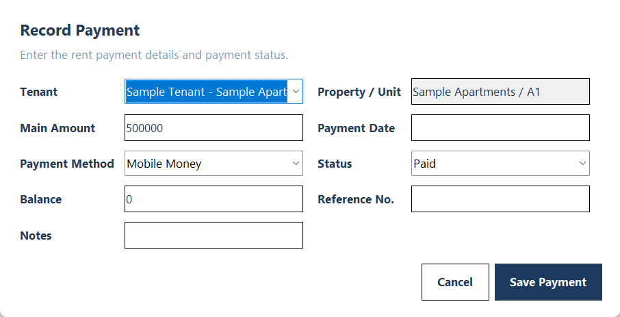

# Rental Management System
## Phase 3 Final Project Report

Student name: NAHABWE DERRICK ERIC

Student ID / registration number: ____________________

Course: Certificate in Software Development with AI (CSDA)

Instructor: AJWADH JALAL

Institution: SAI PALI INSTITUTE OF TECHNOLOGY AND MANAGEMENT

Report date: 2 November 2026

The student name, course, instructor, and institution follow the Phase 1 proposal submitted on 20 July 2026. The student ID and signature should be completed before submission. The application uses the short title Rental Management System; the proposal also calls it the Rental Property Management System. Both refer to the same project.

---

# Declaration

I submit this report as a record of the Rental Management System project. It explains the current program, its design, the checks carried out, and the work that still needs improvement. The approved Phase 1 proposal, project files, and earlier design reports are acknowledged as sources. I am responsible for reviewing the report and explaining the submitted program.

Student signature: ____________________    Date: ____________________

# Acknowledgement

I appreciate the guidance and learning resources provided during the course. The earlier design work gave this project a useful starting point. Python, Tkinter, and the MySQL connector provided the tools needed to build the application.

# Abstract / Executive Summary

Keeping rental information in separate books or files can make it difficult to connect a tenant to a property, check rent payments, and prepare a receipt. The Rental Management System brings these tasks together in one desktop application. It is intended for a landlord or property manager who needs a simple way to keep rental records.

The project uses Python and Tkinter for the screens, MySQL for storage, and mysql-connector-python to connect the program to the database. The main sections are Dashboard, Properties, Tenants, Payments, and Settings. The code supports adding and viewing properties and tenants, deleting selected properties or tenants after confirmation, recording payments, saving payment balances, and creating text receipts. Tenant records can also include paths to identification documents and LC1 letters.

For this report, ten checks were run on source syntax and selected program functions. All ten passed. The function checks used simulated form controls and database calls, so they do not prove that the full application works with a live database or printer. The report separates these results from tasks that still need manual testing.

Compared with the approved proposal, the project delivers part of the intended workflow. Editing, filtered search, lease expiry tracking, automatic vacancy updates, tenant exports, and detailed reports remain incomplete. Deletion also removes related payment history. The result is a useful desktop prototype that needs further work to meet the full approved scope.

# Table of Contents

The PDF contents page lists the chapters and their page numbers. In the Word copy, update the contents field after making changes.

# List of Figures and Tables

Figure 2.1: Final architecture and data flow.

Figure 2.2: Main operation flows.

Figure 2.3: Database relationships.

Figure 3.1: Dashboard with controlled sample data.

Figure 3.2: Tenant entry form with a controlled sample property.

Figure 3.3: Payment entry form with a controlled sample tenant.

Figure 3.4: Application folder and file structure.

Table 1.1: Objectives and current status.

Table 1.2: Project scope.

Table 2.1: Functional requirements.

Table 2.2: Main modules.

Table 2.3: Database fields required by the code.

Table 2.4: Changes from the Phase 2 design.

Table 3.1: Tools and environment.

Table 3.2: Important functions.

Table 4.1: Actual check results.

Table 4.2: Testing summary and pending checks.

Table 4.3: Issues and current handling.

Table 4.4: Evaluation against the objectives.

# Chapter 1 – Introduction and Project Overview

## 1.1 Project Background / Introduction

Rental management involves more than recording a tenant's name. A manager also needs to know the property, unit number, agreed rent, contact details, and payment history. When this information is kept in different places, checking a payment or preparing a receipt takes extra work.

The Rental Management System is a Python desktop application that brings these details into related screens. A sidebar provides access to the dashboard, properties, tenants, payments, and settings. MySQL keeps the records outside the running program so they can be retrieved later.

## 1.2 Problem Statement

The Phase 1 proposal identified the problems caused by managing rentals through paper receipts, logbooks, and basic spreadsheets. As the number of units grows, these methods can lead to misplaced lease agreements, repeated payment entries, inaccurate financial records, and difficulty checking overdue rent. Finding vacant units and preparing monthly financial reports can also take too long.

The approved project therefore proposed a local desktop system to organise property listings, tenants, leases, and rent payments, with faster access to records and useful business summaries. The current application addresses property and tenant registration and payment recording. It does not yet solve the full lease, vacancy, reporting, and history-retention requirements. These gaps are evaluated against the proposal in Sections 1.3, 2.1, and 4.5.

## 1.3 Project Aim and Objectives

The approved main goal is to build a Python-based Rental Property Management System that makes it easier for landlords to track housing units, tenant records, and leasing activities. Table 1.1 follows the six supporting objectives in Phase 1, Section 1.3. Status is based on the current source code and the limited checks reported in Chapter 4; it does not imply a completed live acceptance test.

Table 1.1: Approved Phase 1 objectives and current status.

| Objective from Phase 1 | Current status | Evidence and remaining work |
| --- | --- | --- |
| O1: Add, modify, view, and remove property listings | Partly achieved | Add, list, refresh, and delete exist; modifying listings is absent |
| O2: Register tenants and keep resident profiles up to date | Partly achieved | Registration and viewing exist; tenant editing and managed profile updates are absent |
| O3: Log monthly rent payments and manage active lease terms | Partly achieved | Payment entry and balances exist; T07 checks the calculation. A lease start date is collected, but there is no lease lifecycle, expiry tracking, or move-out workflow |
| O4: Use MySQL for secure, organised storage and retrieval | Partly achieved | Related MySQL queries and transactions exist; persistence needs live verification, and secure authentication is incomplete |
| O5: Automatically create financial summaries and vacancy reports | Partly achieved | Dashboard totals and estimated occupancy exist; detailed financial statements, vacant-unit reports, and tenant exports are absent |
| O6: Apply strict validation and robust error handling | Partly achieved | Selected login, number, date, and balance checks passed; contact, document, duplicate, and range validation remains incomplete |

Text receipts, document-path fields, and company settings are additional implemented features. They support the project but do not replace the approved requirements above.

## 1.4 Project Scope

Table 1.2 compares the approved scope in Phase 1, Sections 2.1 and 2.2, with the delivered program. An omitted in-scope feature remains incomplete; it is not reclassified as out of scope.

Table 1.2: Approved scope and final outcome.

| Area | Approved Phase 1 scope | Current outcome |
| --- | --- | --- |
| In scope: property and unit inventory | Address, rent, layout type, year built, unit number, and add/edit/view/remove operations | Property name, location, unit count, and default rent are stored; unit number is attached to a tenant. No separate unit inventory, layout/year fields, or record editing |
| In scope: tenant registry | Register residents and maintain contact, background, and lease information | Registration, listing, document paths, notes, and deletion exist; editing and full lease records are absent |
| In scope: payments and leasing | Record rent and balances, track lease expiry, process occupancy changes, and preserve history | Payments and an optional lease start date exist; expiry, checkout, vacancy transitions, and preserved history on deletion are absent |
| In scope: filtered search | Filter by location, price range, unit type, or occupancy | No dedicated search or filters |
| In scope: reporting | Vacancy overview, collected rent, outstanding balances, and exportable active-tenant lists | Dashboard summaries and text receipts exist; the specified detailed reports and exports are incomplete |
| In scope: local desktop and data integrity | Tkinter GUI, administrative access, MySQL storage, validation, and error handling | Tkinter and MySQL are present; login is a fixed demonstration check and validation is partial |
| Out of scope: access and hosting | Web access, hosting, mobile apps, cloud storage, and synchronisation | Remain excluded |
| Out of scope: organisation scale | Multiple companies and nationwide branch management | Remain excluded; the program targets one local portfolio |
| Out of scope: advanced services | Online digital lease signing, payment gateways, automated rental-price forecasting, machine learning, virtual tours, and biometric authentication | Remain excluded; payment-method labels do not process online payments |

## 1.5 Intended Users and Benefits

The main users are landlords and property managers. They can use the same application to view properties, identify tenants, record payments, and prepare receipts. The property and tenant dropdowns reduce repeated typing when creating linked records. The dashboard gives a quick summary of the data using the rules described later in this report.

## 1.6 Report Structure

Chapter 2 explains the final design and how it differs from the earlier plan. Chapter 3 describes the code and main features. Chapter 4 gives the actual check results. Chapter 5 explains setup, daily use, limitations, and improvements. Chapter 6 presents the overall outcome and lessons from the project.

# Chapter 2 – System Analysis and Final Design

## 2.1 Functional Requirements

Table 2.1 maps all 22 functional requirements in Phase 1, Sections 3.1–3.6, to the current implementation. The FR identifiers below are assigned for traceability in this report. Implemented in code means the relevant code exists; Chapter 4 separately states what was actually tested.

Table 2.1: Approved functional requirements and delivery status.

| ID / proposal section | Approved requirement | Status and evidence |
| --- | --- | --- |
| FR01 / 3.1 | Secure administrator or manager login | Partial: fixed demonstration credentials; no password hashing or database authentication |
| FR02 / 3.1 | Restrict unauthorised access to backend features | Partial: main screens follow login, but no role enforcement; T05–T06 check only the fixed-login logic |
| FR03 / 3.2 | Add rental listings | Implemented in code: property form and add_property(); detailed unit attributes are limited |
| FR04 / 3.2 | Modify property, pricing, and structural details | Not implemented: no property edit action |
| FR05 / 3.2 | Remove inactive property listings | Implemented in code: confirmed deletion; linked history is also removed |
| FR06 / 3.2 | Display the complete rental-unit inventory | Partial: property list and unit counts exist, but no separate record for each unit |
| FR07 / 3.2 | Search listings using multiple criteria | Not implemented: no location, price, type, or occupancy filters |
| FR08 / 3.3 | Register new residents | Implemented in code: tenant form and add_tenant() |
| FR09 / 3.3 | Update tenant contacts and lease assignments | Not implemented: no tenant editing workflow |
| FR10 / 3.3 | View registered tenants | Implemented in code: tenant table with linked property and unit |
| FR11 / 3.3 | Remove inactive or moved-out tenants from the active registry | Partial: deletion exists, but no managed move-out/archive workflow; payment history is also deleted |
| FR12 / 3.4 | Process active leases for registered tenants | Partial: property/unit assignment and lease start date only; no separate lease records, end dates, renewals, or completion workflow |
| FR13 / 3.4 | Record rent payments and monthly balances | Partial: payment entries and per-entry balances exist; no complete monthly ledger or automatic balance carry-forward; T07–T10 check selected input logic |
| FR14 / 3.4 | Automatically change vacancy status after leasing or checkout | Not implemented: no unit-status lifecycle; dashboard estimates occupancy from tenant counts |
| FR15 / 3.4 | Preserve continuous tenant and financial history | Not met: records remain while retained, but property/tenant deletion removes related payments; no past-lease archive |
| FR16 / 3.5 | Generate current-vacancy summaries | Partial: aggregate occupancy estimate only; no named vacant-unit list or report |
| FR17 / 3.5 | Provide detailed earnings and outstanding-balance reports | Partial: dashboard totals, payment table, and receipts; no detailed period-based financial statement |
| FR18 / 3.5 | Export active-tenant summary lists | Not implemented: tenant viewing does not provide an export |
| FR19 / 3.5 | Display a portfolio dashboard | Implemented in code: cards, occupancy, rent totals, and recent activity; calculation limits are stated in Section 5.4 |
| FR20 / 3.6 | Validate all input formats before database submission | Partial: selected required-field, amount, email, and payment-date checks; document, lease-date, contact, and range checks incomplete |
| FR21 / 3.6 | Actively block duplicate records | Not fully implemented: no comprehensive application-level duplicate checks; database constraints are unverified |
| FR22 / 3.6 | Show informative invalid-input alerts | Implemented for selected conditions: warning/error calls exist; selected cases checked in Chapter 4 |

Persistent MySQL storage and the Tkinter interface are also explicit commitments in the approved scope and technology stack. Both are present in the code. A database save-and-reopen test remains pending, so persistence is not reported as verified by the isolated function checks.

## 2.2 Final System Architecture

The program uses a modular structure. main.py creates the application window, checks database availability, shows the login, and opens the selected page. Each page handles its own form inputs and most validation. data/database.py handles database connections and SQL statements. Shared components provide the header, sidebar, cards, and tables.



Table 2.2: Main modules.

| File or folder | Responsibility | Main interaction |
| --- | --- | --- |
| main.py | Starts the window and switches pages | Creates LoginPage and the five main pages |
| config/settings.py | Stores appearance, defaults, and database configuration | Imported by pages, components, and database code |
| pages/base_page.py | Provides common layouts and form helpers | Inherited by the main content pages |
| pages/*_page.py | Handles each screen and its actions | Reads form values and calls database functions |
| data/database.py | Runs database queries and transactions | Uses mysql.connector and configured MySQL tables |
| components/ | Provides reusable visual controls | Used by main.py and page classes |

There are no separate service or validator packages in this version. Those responsibilities remain mainly inside page methods.

## 2.3 Final Flowcharts

The following diagram shows the current application flow using standard shapes.



The earlier plan included update and search flows. They are omitted from the final operation diagrams because the current application has no corresponding actions. The current code also has no custom exit confirmation for unsaved forms. Each database operation closes its own connection rather than waiting for the program to exit.

## 2.4 Data Structure / Database Design

The storage method is MySQL. Although the template gives several file-based storage examples, MySQL matches this project's actual design. A property can have several tenants, and a tenant can have several payment records. The queries use property_id and tenant_id to connect these records.



Table 2.3: Database fields required by the code. Types and constraints below describe the expected structure inferred from usage. The live table definitions were not inspected, so exact lengths, indexes, keys, and database constraints remain unverified.

| Table | Important fields and expected types | Purpose / illustrative value |
| --- | --- | --- |
| properties | property_id: integer identifier; property_name, location, status: text; total_units: integer; monthly_rent: decimal; extra_details: text | Example: Sample Apartments, Kampala, 10 units, UGX 500000 |
| tenants | tenant_id, property_id: integers; tenant_name, phone, email, unit_number: text; lease_start: date; monthly_rent: decimal | Example: Sample Tenant, unit A1, monthly rent 500000 |
| tenants, continued | emergency_contact, status, kyc_image_path, lc1_letter_path, extra_details: text; created_at: timestamp | Contact, occupancy status, local document paths, notes, and dashboard activity |
| payments | payment_id, tenant_id: integers; amount, balance: decimals; payment_date: date; payment_method, reference_no, status: text; notes: text; created_at: timestamp | Example: amount paid 350000, balance 150000, Cash |
| app_settings | setting_key: text key; setting_value: text | Company name, manager contact, due day, and preference values |
| users | username and role: text; created_at: timestamp | Used for account display; not used to authenticate the login |

The code expects setting_key to support the duplicate-key update used when saving settings. It also expects unique record identifiers. Exact database constraints should be checked with SHOW CREATE TABLE before deployment. The application does not create tables or load a schema file at startup.

## 2.5 User Interface / Menu Design

The main layout uses a left sidebar and a header showing the active page. Dashboard contains summary cards and quick actions. Properties, Tenants, and Payments show tables and buttons above them. Add and record actions open popup forms. Settings contains company details, rent preferences, reminder choices, and account information.

Figures 3.1–3.3 show the current screen code with controlled sample data. They illustrate the interface, not a successful live database session.

## 2.6 Design Changes

The Phase 1-to-delivery comparison is recorded in Tables 1.1, 1.2, and 2.1. The missing search, editing, lease lifecycle, vacancy reporting, exports, and history preservation are incomplete approved work rather than approved scope changes. The project concept and Python/Tkinter/MySQL stack remain consistent with the proposal.

Table 2.4: Changes from the Phase 2 design. Reasons describe the effect of the implementation choice; undocumented developer decisions are not treated as confirmed history.

| Phase 2 design | Current implementation | Effect or explanation |
| --- | --- | --- |
| Separate service and validation modules | Most rules stay in page methods | Fewer modules, but interface and business rules are more closely connected |
| Complete CRUD and search | Add/view plus property and tenant deletion | Planned edit/search work remains incomplete |
| Create schema and sample records during setup | Existing database checked at startup | Database setup must be completed separately |
| Continue with sample data when MySQL is unavailable | Startup shows an error and closes | Startup does not present sample records as saved records |
| Block deletion or reassign related records | Confirm and delete linked records in a transaction | Deletion removes the related history; backups are important |
| Automatic balance handling | User enters the balance for each payment | The stored payment amount is main amount minus entered balance |

# Chapter 3 – System Implementation

## 3.1 Development Environment and Tools

Table 3.1: Tools and environment. Versions refer to the environment inspected for this report, not a claim about every computer used during development.

| Item | Observed tool | Purpose |
| --- | --- | --- |
| Language | Python 3.13.5 | Application logic and screens |
| Interface | Tkinter and ttk | Windows, buttons, forms, dropdowns, and tables |
| Database connector | mysql-connector-python 26.7.0 | Connects Python to MySQL |
| Storage | MySQL; server version not verified | Persistent application records |
| Operating environment | Windows; PowerShell | Commands and Windows receipt printing |
| Editor | Visual Studio Code, specified in Phase 1; version and actual development use not independently verified | Proposed code editor |
| Checks | ast, unittest.mock, and a small report-check script | Syntax and isolated function checks |

The application also uses standard Python modules such as pathlib, datetime, os, and platform. The report-generation libraries are separate documentation tools and are not required to run the rental application.

## 3.2 Project Folder and File Structure




Package folders also contain __init__.py files. The earlier report scripts and Phase 2 documents are supporting material. No current schema.sql file is available in the working project, so a separate database export is needed for a complete handover.

## 3.3 Implemented Modules and Functions

Table 3.2: Important functions.

| Function | Input | Result |
| --- | --- | --- |
| initialize_database() | Configured connection | Checks that the five required tables can be read |
| check_login() | Username and password controls | Opens the main layout or requests an error message |
| show_page(page_name) | Page name | Raises the page, updates navigation, and refreshes it |
| add_property(property_data) | Property dictionary | Inserts a property and returns its ID |
| add_tenant(tenant_data) | Tenant dictionary | Inserts a tenant linked to a property |
| add_payment(payment_data) | Payment dictionary | Inserts a payment linked to a tenant |
| get_properties(), get_tenants(), get_payments() | No form input | Returns records for the relevant tables |
| delete_property(), delete_tenant() | Selected record ID | Removes the record and its related records |
| get_dashboard_summary() | Current database records | Returns counts, payment totals, and recent activity |
| save_app_settings(settings_data) | Setting key/value pairs | Inserts or updates stored preferences |
| _create_receipt_file(payment_record) | Selected payment record | Creates a printable text receipt |

## 3.4 Implementation of Major Features

### Property management

The manager clicks Add Property and enters a name, location, number of units, monthly rent, and optional extra details. The page checks required values, whole-number units, and numeric rent. A dictionary is passed to the database function, which inserts the record with Active status. The table is reloaded after a successful save.

Delete Selected requires a row and a confirmation. The database code deletes payments linked through the property's tenants, then the tenants, and finally the property. The changes are committed together. If the operation fails, the transaction is rolled back.

### Tenant management

The tenant form loads active properties from MySQL. Selecting a property fills the default monthly rent, which can then be changed for that tenant. The manager enters the tenant name, phone, unit number, and rent. Optional details include email, lease start date, emergency contact, status, document paths, and notes.

KYC means Know Your Customer; the field can refer to a tenant identification image. LC1 refers to a local council letter. The program saves the selected file paths. It does not copy the documents into a managed storage folder. A tenant deletion also removes that tenant's payment records after confirmation.

### Payment recording and balances

The payment form loads active tenants and fills the related property, unit, and monthly rent. The user enters the payment date, main amount, balance, method, status, and any reference or notes. Supported methods are Cash, Mobile Money, Bank Transfer, and Card. These are labels for recording a payment; the program does not process an online transaction.

The calculation is: amount paid = main amount − balance. For example, a main amount of UGX 500000 and a balance of UGX 150000 produces a saved amount paid of UGX 350000. The code rejects a negative balance or a balance greater than the main amount. It also parses the payment date before saving. Status is selected by the user rather than calculated from the balance.

### Receipt creation

The manager selects a payment and clicks Print Receipt. The program creates a text file in data/receipts. It includes company details, receipt number, tenant, property, unit, date, main amount, amount paid, balance, method, reference, status, and notes. On Windows, the program asks the default application to print the file. A saved receipt does not prove that physical printing succeeded.

### Dashboard and settings

The dashboard counts active properties, total units in active properties, and active tenants. It sums current-month payments whose status is Paid. Pending rent is the larger of zero and expected active-tenant rent minus that total. Occupancy uses active tenant count divided by total units, with a maximum display of 100 percent.

Settings can save company and manager details, currency preference, due day, late fee, and reminder preferences. Saving these preferences does not send reminders or apply a late fee automatically. Several money displays still use UGX directly.

## 3.5 Input Validation and Error Handling

Property forms reject missing required values and unit counts containing letters. Tenant forms require the key tenancy details, check that a selected property exists in the dropdown mapping, and make a basic email check for an @ character. Payment forms require a selected tenant, numeric amounts, a valid payment date, and a balance within the supported range. Settings checks the due day against 1–31 and requires a numeric late fee.

Validation is incomplete. Property and tenant rent values do not have a clear non-negative check. Zero units are accepted. Phone format, document existence, duplicate unit assignments, and a tenant's lease date are not fully checked by the forms. Duplicate-record behaviour depends on the existing database constraints. Save errors are shown in a database error dialog.

At startup, an unavailable database or unreadable required table prevents the main program from opening. Some later read functions return an empty list when a connection cannot be made. This can make an unavailable database look like an empty table; errors during an established query may also propagate. Error handling should be made more consistent.

## 3.6 Data Storage and Retrieval

Database functions open a connection, run a query, and close the cursor and connection. Insert operations use parameter placeholders for record values and commit successful writes. The delete functions roll back when a related deletion fails. Settings uses an insert-or-update query so existing preference values can change.

The tables read data from MySQL rather than an in-memory list. This design supports retaining saved records after closing the application. A real save-and-reopen test was not performed for this report. Document files remain separate from the database, while receipts are local text files.

## 3.7 Screenshots of the Completed Application

The following screenshots were captured from the current page classes during report preparation. Database calls were replaced with controlled sample values. The application widgets are real Tkinter widgets; the sample records are illustrative and were not written to MySQL. These figures show the current interface without claiming a live database test.



The dashboard shows property and tenant counts, rent figures, occupancy, recent activity, and quick-action buttons. The figures are sample values used to demonstrate the layout.



The form groups contact details, property assignment, rent, document paths, notes, and status. Document fields store paths to files selected by the user.



The payment form separates the main amount from the balance. The property and unit are filled from the tenant selected in the dropdown.

No screenshot is presented as evidence of a live save, deletion, restart, or successful printer output. Those checks remain pending in Chapter 4.

# Chapter 4 – Testing and Results

## 4.1 Testing Approach

Ten checks were run during report preparation using report_checks.py. One parsed all 18 application Python files for syntax errors. The remaining checks exercised selected functions with normal, invalid, or boundary inputs. Login and payment tests used simple simulated input controls. Database saves and message boxes were replaced with mocks, which record calls without changing database records or opening dialogs.

This approach checks specific logic safely. It does not test the MySQL server, real mouse and keyboard interaction, the Windows printer, or persistence after restarting. The screenshots in Chapter 3 are interface evidence using controlled data, separate from the pass/fail checks.

## 4.2 Test Cases and Actual Results

Table 4.1: Actual check results.

| ID / feature | Input / expected result | Actual result | Status |
| --- | --- | --- | --- |
| T01: Source syntax | Parse all application Python files. Expected: No syntax errors | All 18 application Python files parsed successfully. | Pass |
| T02: Money conversion | UGX 1,200,000. Expected: 1200000.0 | Returned 1200000.0. | Pass |
| T03: Money conversion | abc. Expected: ValueError | Raised ValueError as expected. | Pass |
| T04: Receipt filename | Sarah / Namuli. Expected: Replace spaces and slash with underscores | Returned Sarah___Namuli. | Pass |
| T05: Login logic | Correct default credentials; mocked controls. Expected: Allow login | Success callback called; no error message. | Pass |
| T06: Login logic | Wrong password; mocked controls. Expected: Reject login and clear password | Error requested, password cleared, success callback not called. | Pass |
| T07: Partial payment | Main amount 500000, balance 150000, date 2026-11-02. Expected: Save amount paid 350000 | Save received amount 350000 and balance 150000; no real database write. | Pass |
| T08: Balance validation | Balance -1. Expected: Invalid Balance; block save | Invalid Balance warning requested; database save not called. | Pass |
| T09: Balance validation | Balance 600000, main amount 500000. Expected: Invalid Balance; block save | Invalid Balance warning requested; database save not called. | Pass |
| T10: Date validation | 2026-02-30. Expected: Invalid Date; block save | Invalid Date warning requested; database save not called. | Pass |

Each result is recorded in reports/test_evidence.json. The script can be rerun with python -B report_checks.py from the project folder. A passing syntax check confirms that the files parse; it does not prove that all runtime paths work.

## 4.3 Testing Summary

Table 4.2: Testing summary and pending checks.

| Item | Result |
| --- | --- |
| Checks executed | 10 |
| Passed | 10 |
| Failed | 0 |
| Pending manual or integration scenarios listed below | 8 |
| Live database writes performed for this report | 0 |

The eight pending scenarios are: (1) live property save and reload; (2) live tenant save with document paths; (3) live payment save and joined history; (4) property deletion with related records; (5) tenant deletion with related payments; (6) settings save and reset; (7) closing and reopening to confirm persistence; and (8) receipt file creation and actual printing. These are pending scenarios, not passed tests. They should use a separate test database and sample records.

## 4.4 Problems Encountered and Solutions

Table 4.3: Issues and current handling. These are issues visible in the reviewed implementation and design; the table does not invent a development history.

| Issue | Cause or evidence | Current action and outcome |
| --- | --- | --- |
| Application depends on prepared MySQL tables | Startup reads five existing tables | Clear startup failure is implemented; database export still needed |
| Related records complicate deletion | Payments depend on tenants and properties | Ordered deletes and rollback handling are implemented; live test pending |
| Incorrect payment input can change amounts | Main amount and balance are separate inputs | Numeric/date/balance checks present; selected cases passed T07–T10 |
| Planned edit/search features are absent | No matching actions in the current pages | Listed as incomplete rather than claimed as delivered |
| Authentication is unsuitable for real deployment | Credentials are fixed in configuration | Remains unresolved; secure authentication is recommended |

## 4.5 Evaluation Against Objectives and Requirements

Table 4.4 uses the six approved objectives from Phase 1, Section 1.3. The ten passing checks confirm specific behaviour only; they do not demonstrate that all approved requirements were achieved.

Table 4.4: Evaluation against the approved Phase 1 objectives.

| Objective / related requirements | Evidence from implementation or testing | Final evaluation |
| --- | --- | --- |
| O1: Full property control / FR03–FR07 | Add/view/delete code; no editing, filtered search, or complete unit inventory | Partly achieved |
| O2: Tenant registry and current profiles / FR08–FR11 | Registration and listing code; no profile editing or history-preserving move-out | Partly achieved |
| O3: Payment and lease management / FR12–FR15 | T07 checks partial-payment payload; T08–T10 check selected invalid values. Lease start field exists; no lease completion, vacancy transition, or retained archive | Partly achieved |
| O4: Secure, organised MySQL storage / FR01–FR02 and approved storage scope | MySQL query/transaction code exists; T05–T06 verify only demonstration login. Live persistence and security acceptance remain outstanding | Partly achieved |
| O5: Financial and vacancy reporting / FR16–FR19 | Dashboard and receipts exist; detailed reports, vacant-unit listing, and active-tenant export do not | Partly achieved |
| O6: Strict validation and robust errors / FR20–FR22 | T03, T06, T08–T10 verify selected failures; several data checks and duplicate controls remain incomplete | Partly achieved |

The result is a partial implementation of the approved proposal. The eight integration scenarios in Section 4.3 remain pending for existing features. Missing features require implementation and new acceptance tests before their requirements can be marked as achieved. Priority acceptance scenarios include filtered unit search, tenant/property editing, lease expiry and move-out, automatic vacancy updates, preserved history after archiving, financial report totals, active-tenant exports, and duplicate prevention.

# Chapter 5 – User Guide and Project Completion

## 5.1 System Requirements

Use a computer with Python and working Tkinter support. Python 3.13.5 is the version inspected for this report. Install mysql-connector-python from requirements.txt. A running MySQL server and the five correctly structured tables are required. Windows is required for the current automatic print request; other systems can still receive a saved text receipt.

Keep tenant documents in stable, accessible folders. The program stores their paths, so moving or deleting a document can break the reference. A configured default printer and a text-file application that supports printing are needed for Windows receipt printing.

## 5.2 Installation / Setup Instructions

1. Copy the project folder to the computer and open a terminal in that folder.
2. Run python --version and confirm that Python is available. Run python -m tkinter to check Tkinter support.
3. Install the connector with python -m pip install -r requirements.txt.
4. Start MySQL using the server installation available on the computer.
5. Import an appropriate database export or create the required tables separately. Use the fields identified in Section 2.4 and compare them with every query in data/database.py. This project does not currently include an authoritative schema export, so this step needs the developer's verified database structure.
6. Check config/settings.py. The defaults are localhost, port 3306, user root, and database rental_management_system. Connection values can also be supplied through RMS_DB_HOST, RMS_DB_USER, RMS_DB_PASSWORD, RMS_DB_NAME, and RMS_DB_PORT.
7. Run python main.py. If a database error appears, check the connection and table structure before continuing.
8. Sign in with the current demonstration credentials: username eric and password 12345.

A clean installation cannot be described as fully verified until the database export is included and the pending integration scenarios pass. Back up a real database before using deletion actions.

## 5.3 How to Use the Application

1. Start the program and log in. Use the sidebar to open the required page.
2. Open Properties and click Add Property. Fill in the required details and save. Confirm that the record appears in the table.
3. Open Tenants and click Add Tenant. Choose the property, enter the tenant and unit details, and add optional document paths or notes. Save the form.
4. Open Payments and click Record Payment. Choose the tenant, check the main amount, enter the balance and payment date in YYYY-MM-DD format, and select the method and status. Save the payment.
5. Select a recorded payment and click Print Receipt. If printing fails after the file is saved, use the displayed saved path to open the text receipt.
6. Open Dashboard or click Refresh to retrieve current summaries. Remember that its payment total includes only current-month records marked Paid.
7. Use Settings to save company details and preferences. Reminder options store choices; they do not send messages.
8. To delete a property or tenant, select the row and read the confirmation carefully. Related payments are also removed. Cancel to keep the records.
9. Finish or cancel an open form before closing the main window. Unsaved form entries are not retained.

## 5.4 Known Limitations

Against the approved Phase 1 scope, the system lacks separate unit records with layout type and year built, multi-criteria search, property and tenant editing, lease end dates and expiry alerts, renewal or move-out processing, automatic vacancy changes, exportable active-tenant lists, and the specified detailed reports. There is also no account sign-out action from the proposal’s prototype menu. The proposal requires continuous tenant and payment history, but the current delete functions remove related payment records. These are delivery gaps within the approved scope.

The login uses one fixed username and password stored in plain text. It does not authenticate against the users table, and the account display does not provide real access control. Record editing, dedicated search, and payment correction or deletion actions are absent.

The dashboard is a summary rather than a full rent-accounting ledger. Payments marked Pending or Overdue are excluded from the current-month collection total even if an amount was entered. Payment-status counts and overdue-tenant counts are not restricted to the current month. Occupancy assumes one active tenant per occupied unit; the code does not fully enforce that assumption. No automatic schedule decides which tenants are overdue.

Balances belong to individual payment records. They are entered manually and are not automatically carried forward across rental periods. Reminder, late-fee, and backup preferences are stored without implementing those services. Currency selection does not update every money display.

Tenant documents are referenced by local paths without managed copying or complete file checks. Validation is limited for rents, dates outside the payment form, duplicate units, and contact formats. Monetary input is converted through floating-point values. The project also needs a verified database export and full live testing before handover.

## 5.5 Recommendations for Future Improvement

The first priority is to complete the outstanding approved requirements, rather than expand into the services excluded in Phase 1. Add unit-level inventory and filtered search, property and tenant editing, lease dates and lifecycle actions, automatic vacancy updates, history-preserving archiving, tenant-list exports, detailed financial/vacancy reports, and account sign-out. Each feature needs an acceptance test linked to its requirement in Table 2.1. Web, mobile, cloud, payment-gateway, biometric, and automated price-forecasting features remain outside this project’s approved scope.

First, include a verified database setup script or export and complete the pending integration tests. Add stronger validation for money, dates, documents, and unit assignments. Use decimal-based money calculations throughout.

Next, replace the demonstration login with securely stored password hashes and proper user roles. Add editing, search, and a controlled way to correct payment errors while keeping an audit history. Consider archiving tenants and properties so that historical payments are preserved.

Finally, build a rent ledger that tracks periods, partial payments, and carried-forward balances. Use that ledger for accurate arrears and dashboard totals. Add managed document storage, consistent currency formatting, database backups, and optional reminder delivery only after the main record workflow is verified.

# Chapter 6 – Conclusion

## 6.1 Project Summary

The Rental Management System brings property, tenant, and payment records into one Python desktop application. Tkinter provides the screens and MySQL provides storage. The current code includes record entry, linked tables, confirmed property and tenant deletion, dashboard summaries, settings, and text receipt creation.

## 6.2 Achievement of Objectives

All six approved objectives are partly achieved. The application provides property and tenant entry, payment recording, a dashboard, and MySQL access. It does not yet deliver full record control, complete lease management, automatic vacancy tracking, the specified reports and exports, secure authentication, comprehensive validation, or reliable history preservation.

Ten checks passed for syntax and selected login, input conversion, payment calculation, and validation behaviour. These results do not change the status of missing features. The eight live integration scenarios remain pending. Table 4.4 explains the outcome for each approved objective, and Table 2.1 provides the detailed requirement mapping.

## 6.3 Lessons Learnt

The project shows why clear links between data matter. A tenant needs a property, and a payment needs a tenant. These relationships affect both display queries and deletion. It also shows the value of reusable page layouts and table controls, which keep the interface consistent.

Another lesson is that a saved preference is different from a working service: a reminder option needs actual delivery code. Testing also needs clear boundaries. A function check can verify a calculation, while a database test is needed to verify that a record is really saved and retrieved. Reporting those differences honestly makes the final result easier to assess.

## 6.4 Final Remarks

The application provides a practical starting point for managing rental information. Its next stage should focus on reliable database setup, complete testing, stronger security, and the remaining record-management features.

# References

1. Nahabwe Derrick Eric. Python Project – Phase 2: Design & Incubation Report. Prepared 18 August 2026. Local file: Phase2_Design_And_Incubation_Nahabwe_Derrick_Eric.pdf. Used for the earlier system design; Phase 1 supplies the approved objectives and cover details.
2. Python Phase 3 Final Project Report and Presentation Template. User-provided PDF, reviewed 2 November 2026. Used for report structure and formatting.
3. Rental Management System project source files and README.md. Current workspace version reviewed 2 November 2026. Main evidence: main.py, config/settings.py, pages/, components/, and data/database.py.
4. Report preparation checks. report_checks.py and reports/test_evidence.json, 2 November 2026. Used for the actual results in Chapter 4.
5. Nahabwe Derrick Eric. A Rental Management System: Project Proposal. Submitted 20 July 2026. User-provided file: python_project_proposal_Nahabwe_Derrick_Eric (1).pdf. Used for the approved problem, six objectives, scope, functional requirements, proposed tools, and student/course/instructor/institution details.

No external website is listed as a development source because its use during development was not established from the available evidence.

# Appendices

## Appendix A – Final Source Code

The source code is in the project folder described in Section 3.2. Submit that folder separately from the report. The report does not claim that a source-code archive has already been prepared. Include a verified database export so an assessor can reproduce the setup.

## Appendix B – Additional Screenshots and Output Samples

Figures 3.1–3.3 are current-interface captures with controlled sample data. The existing assets/report_project_screen.png and assets/report_add_tenant_screen.png are earlier project images and were not used as proof of the current database behaviour.

Illustrative receipt content follows. It explains the expected output format; it is not a receipt generated from a live payment during these checks.

```text
Sample Rentals
RENT PAYMENT RECEIPT
Receipt No.: 1
Payment Date: 2026-11-02
Tenant: Sample Tenant
Property: Sample Apartments
Unit: A1
Main Amount: UGX 500,000.00
Amount Paid: UGX 350,000.00
Balance: UGX 150,000.00
Payment Method: Cash
Status: Paid
```

## Appendix C – Full Test Evidence

The machine-readable results are in reports/test_evidence.json. Run python -B report_checks.py to repeat the ten checks. The script does not write rental records to MySQL. The pending scenarios in Section 4.3 should be run separately on a test database, with expected and actual outcomes recorded.

## Appendix D – Sample Data / Database Structure

All sample names, amounts, contacts, and property details used for this report are illustrative. The expected relationship is properties.property_id to tenants.property_id, and tenants.tenant_id to payments.tenant_id. The exact deployed schema, foreign keys, unique constraints, and server version still need to be confirmed from the real database. No private tenant data or database password is included in this report.

## Appendix E – Supporting Documents

The Phase 1 proposal defines the approved problem, objectives, scope, and requirements. The Phase 2 reports describe the design and planned improvements. This Phase 3 report compares the delivered code with that approved proposal and identifies incomplete requirements explicitly.
