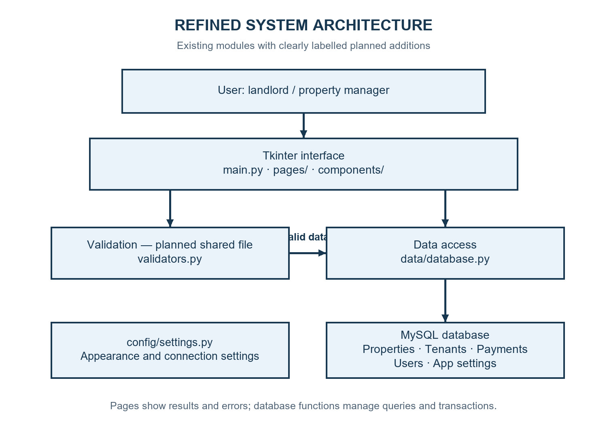
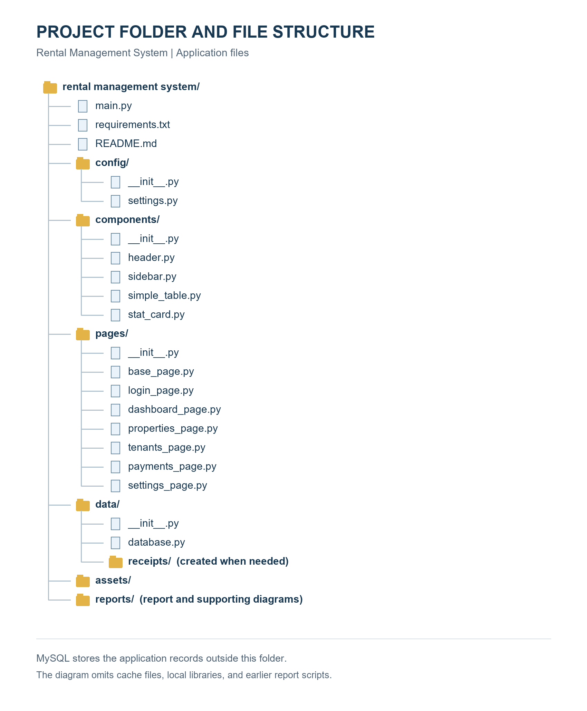
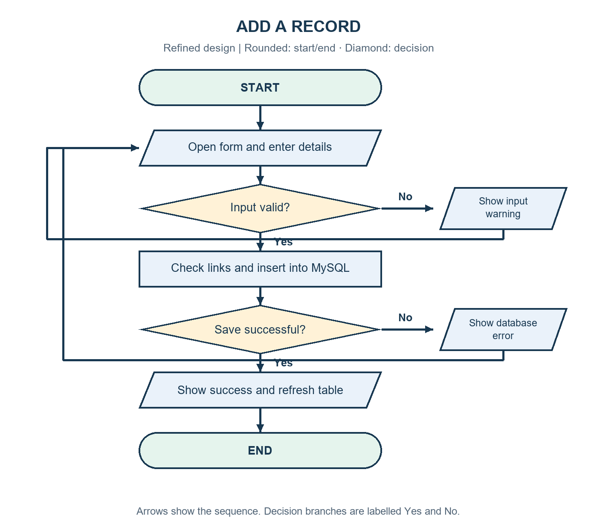
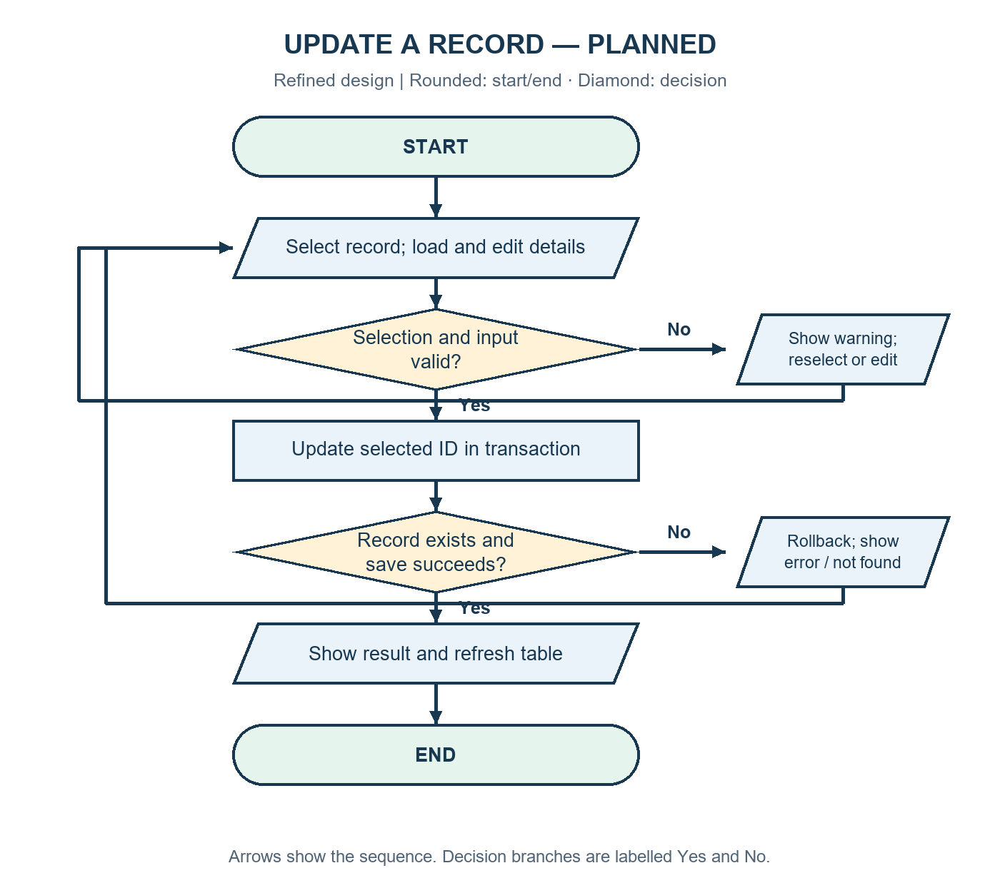
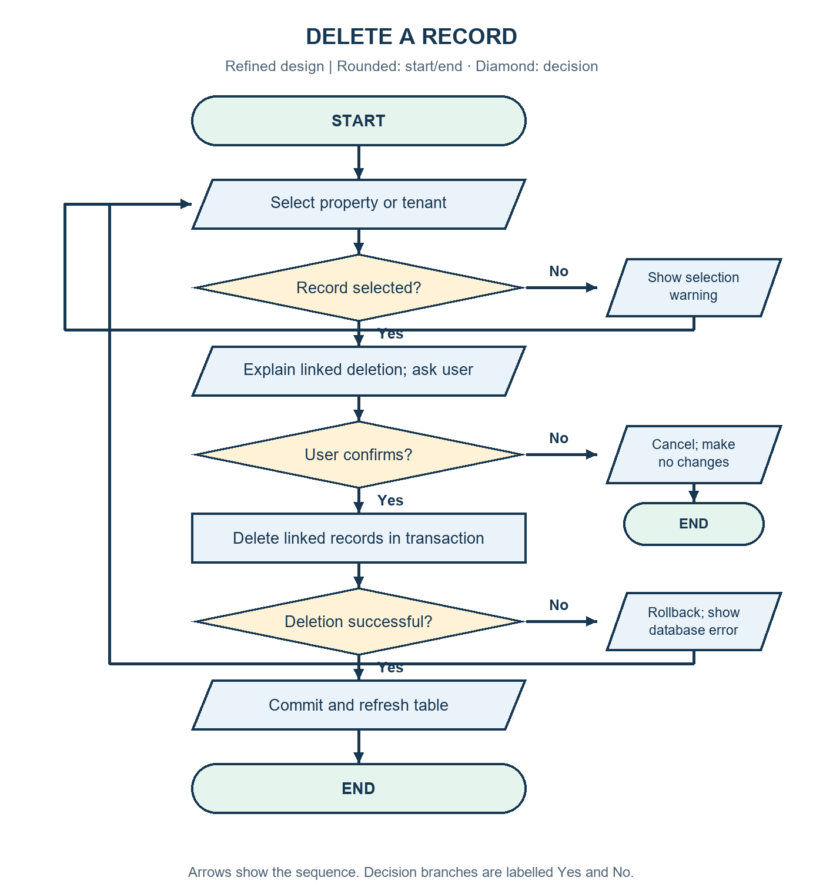
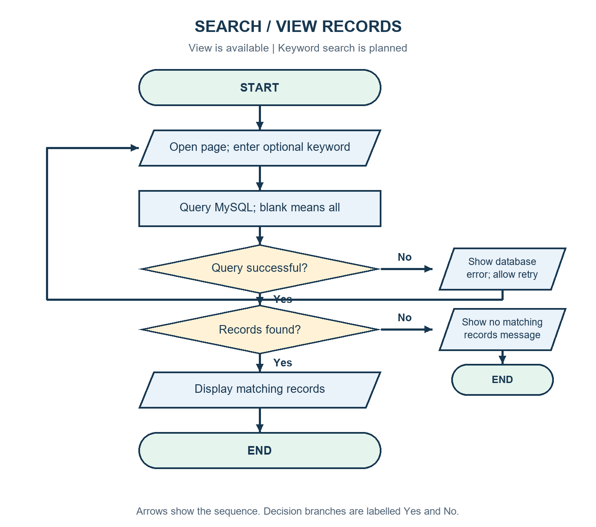
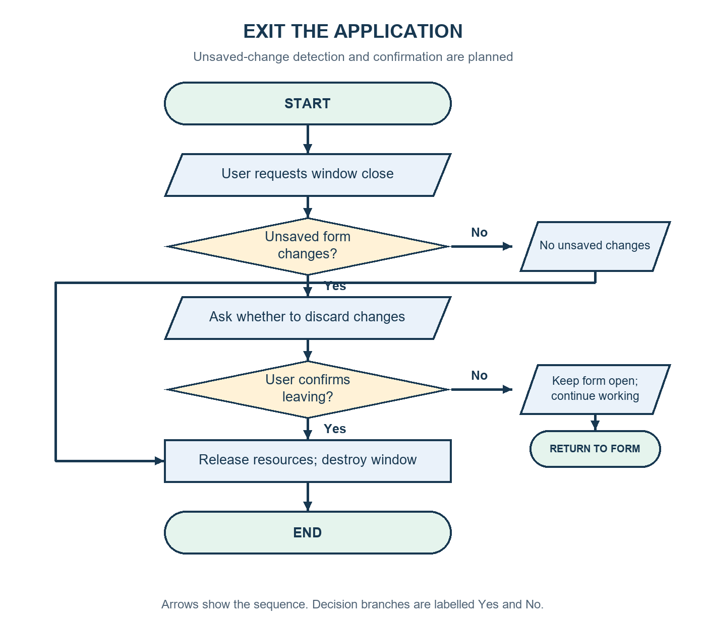
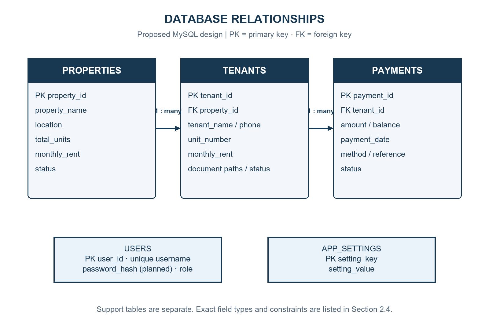
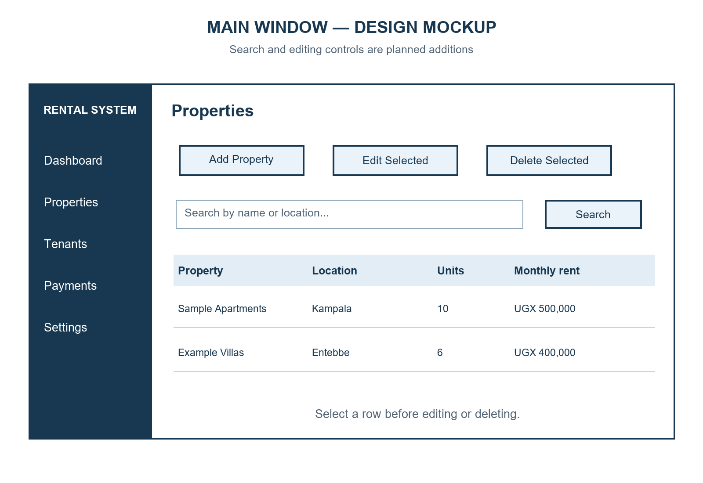
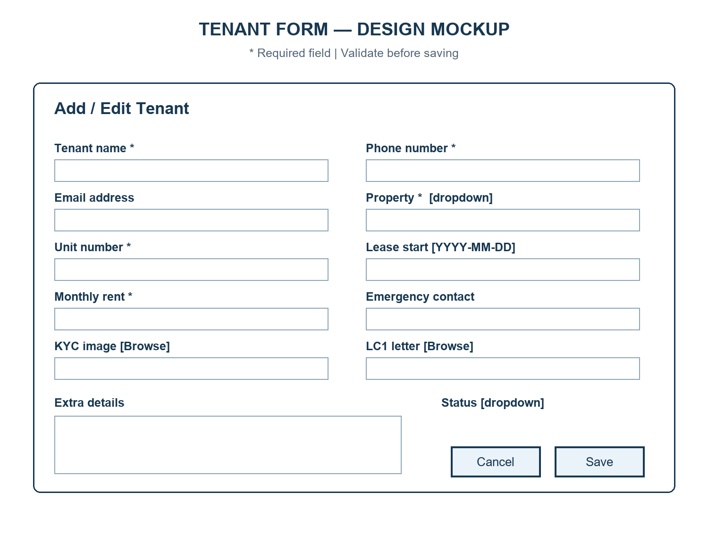

# Rental Management System
## Phase 2 — Design and Incubation Report

Student name: NAHABWE DERRICK ERIC

Course: Certificate in Software Engineering with Artificial Intelligence

Student ID: ____________________

Instructor: ____________________

Institution: ____________________

Report date: 2 November 2026

---

# Table of Contents

# 1. Purpose and Project Overview

The Rental Management System is a desktop application for keeping property, tenant, and rent-payment information in one place. It is intended for a landlord or property manager who needs to register tenants, record payments, check balances, and prepare receipts.

This Phase 2 report explains how the system is organised and how its main functions should work. It follows the eight submission areas in the supplied Phase 2 guidelines: architecture, flowcharts, function design, database design, interface design, error handling, testing, and development timeline.

The project already has Python and Tkinter screens and MySQL data functions. This report uses those files as a starting point and describes the design needed to complete and improve the system. Editing, search, stronger validation, managed documents, and confirmation before leaving an unsaved form are planned features. A diagram or test case in this design report does not mean that the feature has already been implemented or tested.

The main objectives are to keep rental records connected, reduce repeated typing, save records reliably, support clear payment tracking, and give the user useful summaries. The first version will be a desktop system. Online payment processing, a tenant web portal, and cloud synchronisation are outside this design.

# 2.1 Refined System Architecture

## 2.1.1 Overall design

The application will use three main responsibilities. The interface will display screens and collect input. Validation will check whether the input is complete and sensible. The data layer will save and retrieve records from MySQL. The page methods will coordinate these steps.

Existing page classes already contain validation. The refined design proposes moving common checks into validators.py so that property, tenant, and payment forms use the same rules. This file is planned; it is not part of the current application.



The interface calls validation before saving. Once the values are accepted, it sends a dictionary to data/database.py. That module uses parameterised SQL statements and returns records or operation results. The interface then refreshes the relevant table. Error messages are shown at the page level.

## 2.1.2 Modules and responsibilities

Table 2.1: Main modules and their interactions.

| Module or file | Responsibility | Main interaction |
| --- | --- | --- |
| main.py | Start the application, check storage, show login, and switch pages | Creates page classes and controls the active screen |
| config/settings.py | Keep appearance, window, and database settings together | Read by the interface and database layer |
| components/ | Provide reusable header, sidebar, cards, and tables | Used by the main window and pages |
| pages/base_page.py | Provide common page and popup helpers | Used by the main record pages |
| pages/login_page.py | Collect login details and display a result | Opens the main layout after a successful login |
| pages/dashboard_page.py | Display totals, recent activity, and quick actions | Reads get_dashboard_summary() |
| pages/properties_page.py | Manage property forms and records | Calls property data functions |
| pages/tenants_page.py | Manage tenants and document references | Reads properties and calls tenant functions |
| pages/payments_page.py | Record payments and prepare receipts | Reads tenants, saves payments, and writes receipt files |
| pages/settings_page.py | Manage company details and preferences | Reads and writes app_settings |
| data/database.py | Open connections, run queries, and manage transactions | Connects to MySQL and returns results |
| validators.py — planned | Check required fields, dates, money, and contact formats | Called by page save methods |

The current fixed demonstration login will need stronger authentication before real deployment. The refined design will store password hashes in users and check the selected user's role. Password hashing and role enforcement are planned work.

## 2.1.3 Project folder and file structure



The existing folder structure separates pages, shared components, configuration, and data access. The planned validators.py file will be added at the project root. A verified schema.sql file should be added under data/ for a repeatable database setup. Neither planned file is shown as an existing application file in Figure 2.2. Receipt files will be created under data/receipts when needed.

# 2.2 Detailed Flowcharts

These flowcharts describe the intended behaviour of the refined system. Rounded shapes show start and end, parallelograms show input and output, rectangles show processing, and diamonds show decisions. Each decision has labelled branches. Database failures lead to an error message without a false success message.

## 2.2.1 Add a record

The user opens the relevant form, enters values, and saves. The system checks required fields, types, ranges, and related records. Valid data is inserted into MySQL. A failure keeps the form open so the user can correct the entry or retry.



For a tenant, the property must exist. For a payment, the tenant must exist, the date must be valid, and the balance must be between zero and the main amount. The payment amount is main amount minus balance.

## 2.2.2 Update a record — planned

The user selects an existing property or tenant. The system loads the saved details into an edit form. After validation, it updates the selected ID and checks whether the row still exists. An error leaves the original data unchanged. Editing is not available in the current record pages.



Payment corrections should preserve a reason and history rather than silently replacing financial records. That audit-history design is a later improvement; the first edit work will focus on properties and tenants.

## 2.2.3 Delete a record

The user selects a property or tenant and reads a confirmation explaining which linked records will also be removed. Cancellation changes nothing. A confirmed deletion runs in one transaction so that either all related changes succeed or all are rolled back.



The current project deletes a tenant's payments before deleting the tenant. Property deletion also deletes its tenants and their payments. This design documents that behaviour. A future version should consider archiving records to preserve rental history.

## 2.2.4 Search or view records

Opening a page will load its saved records. The planned search option will accept a keyword and return matching records. An empty keyword will show all records. No matches will produce a clear message rather than an unexplained blank area. Dedicated search is planned; listing and refreshing already exist.



## 2.2.5 Exit the application

The refined design will detect an unsaved form and ask whether the user wants to leave. If the user chooses to keep working, the form remains open. Otherwise, temporary resources are closed and the main window is destroyed. An exit confirmation is planned; the current main window closes without this check.



# 2.3 Function-Level Design

Table 2.2: Startup, navigation, and validation functions. Proposed contracts are labelled where they differ from the existing code.

| Function | Purpose and parameters | Return value and internal logic |
| --- | --- | --- |
| initialize_database() | Check storage; no parameters | Existing: True on success; raises DatabaseUnavailable if a connection or required table cannot be read |
| get_connection(use_database=True) | Open MySQL using configuration | Existing: connection object; raises DatabaseUnavailable on connection failure |
| check_login(event=None) | Read username and password from the login controls | Existing: no return value; opens the layout or displays an error. Planned: verify a stored password hash |
| show_page(page_name: str) | Display the chosen page | Existing: no return value; raises the stored page, updates header/sidebar, and refreshes records |
| validate_record(kind: str, values: dict) — planned | Apply the rules for a property, tenant, or payment | Proposed: cleaned dictionary and error list; checks required values, types, ranges, and dates |
| parse_money(value: str) — planned | Convert a money entry consistently | Proposed: Decimal; reject invalid, negative, or non-finite values |
| confirm_exit(has_unsaved_changes: bool) — planned | Protect unsaved form entries | Proposed: True to close or False to continue working |

Table 2.3: Record and settings functions.

| Function | Purpose and parameters | Return value and internal logic |
| --- | --- | --- |
| get_properties(), get_tenants(), get_payments() | Read saved records; no parameters | Existing: list of dictionaries. Tenant/payment queries join related tables |
| get_property_options(), get_tenant_options() | Load dropdown choices; no parameters | Existing: list of active property or tenant records |
| add_property(property_data: dict) | Insert a property | Existing: inserted ID; execute parameterised INSERT, commit, and close resources |
| add_tenant(tenant_data: dict) | Insert a tenant linked to a property | Existing: inserted ID; optional values may be stored as NULL |
| add_payment(payment_data: dict) | Insert the calculated amount paid and entered balance | Existing: inserted ID; commit a payment linked to the selected tenant |
| update_property(id: int, values: dict) — planned | Change a selected property's details | Proposed: affected-row count; update by ID; check existence separately because unchanged values can also affect zero rows |
| update_tenant(id: int, values: dict) — planned | Change a selected tenant's details | Proposed: affected-row count; check the property and values, then update by ID |
| delete_property(id: int), delete_tenant(id: int) | Remove a selected record and its dependants | Existing: final delete row count; ordered deletes, commit on success, rollback on failure |
| search_records(kind: str, keyword: str) — planned | Find records by approved text fields | Proposed: list of dictionaries; map kind to fixed queries and pass keyword through placeholders |
| get_dashboard_summary() | Build the dashboard figures | Existing: summary dictionary or None when connection is unavailable |
| save_app_settings(settings_data: dict) | Save company details and rent preferences | Existing: no return value; insert or update keys and commit |
| _create_receipt_file(payment_record: dict) | Create a text receipt | Existing: Path to the saved file; combine payment, tenant, and company details |

In the refined design, database read errors will raise a clear application error rather than return an empty list. This will let the interface distinguish a failed query from a table that has no records.

# 2.4 Final Data Structure / Database Schema

## 2.4.1 Storage choice and relationships

The project will retain MySQL because the existing application already uses mysql-connector-python and related tables. The guideline lists several example storage methods; MySQL is used here to match the actual project. The proposed schema below is the Phase 2 design target, not a verified export of the installed database.



All tables will use a transactional storage engine such as InnoDB. Money will use DECIMAL(12,2). Dates will use DATE. Identifiers will use integer primary keys. Phone numbers will use text so that a leading zero or plus sign is retained. created_at will default to the current timestamp.

## 2.4.2 Properties table

Table 2.4: Proposed properties fields.

| Field | Type | Constraint / purpose |
| --- | --- | --- |
| property_id | INT | Primary key; auto increment |
| property_name | VARCHAR(120) | Required name |
| location | VARCHAR(160) | Required location |
| total_units | INT | Required; greater than zero |
| monthly_rent | DECIMAL(12,2) | Required; zero or greater; default rent per unit |
| status | VARCHAR(30) | Required; Active or Inactive; default Active |
| extra_details | TEXT | Optional notes |
| created_at | TIMESTAMP | Required; default current timestamp |

## 2.4.3 Tenants table

Table 2.5: Proposed tenants fields.

| Field | Type | Constraint / purpose |
| --- | --- | --- |
| tenant_id | INT | Primary key; auto increment |
| property_id | INT | Required foreign key to properties.property_id |
| tenant_name | VARCHAR(120) | Required full name |
| phone | VARCHAR(40) | Required contact; shared family numbers allowed |
| email | VARCHAR(160) | Optional; validate when provided |
| unit_number | VARCHAR(40) | Required; active unit assignment checked before saving |
| lease_start | DATE | Optional valid date |
| monthly_rent | DECIMAL(12,2) | Required; zero or greater |
| emergency_contact | VARCHAR(160) | Optional contact information |
| status | VARCHAR(30) | Active, Pending Move-in, or Notice Given |
| kyc_image_path | VARCHAR(500) | Optional identification-document path |
| lc1_letter_path | VARCHAR(500) | Optional local council letter path |
| extra_details | TEXT | Optional notes |
| created_at | TIMESTAMP | Required; default current timestamp |

The design will check whether an active tenant already occupies a unit before assigning another active tenant to it. A simple unique key on property_id and unit_number would also block historical occupants, so that rule needs careful handling. A later design may introduce separate unit and tenancy tables.

## 2.4.4 Payments table

Table 2.6: Proposed payments fields.

| Field | Type | Constraint / purpose |
| --- | --- | --- |
| payment_id | INT | Primary key; auto increment |
| tenant_id | INT | Required foreign key to tenants.tenant_id |
| amount | DECIMAL(12,2) | Required; amount actually paid; zero or greater |
| balance | DECIMAL(12,2) | Required; zero or greater; default zero |
| payment_date | DATE | Required valid date |
| payment_method | VARCHAR(40) | Cash, Mobile Money, Bank Transfer, or Card |
| reference_no | VARCHAR(80) | Optional unique reference; blank values stored as NULL |
| notes | TEXT | Optional payment explanation |
| status | VARCHAR(30) | Paid, Pending, or Overdue |
| created_at | TIMESTAMP | Required; default current timestamp |

Main amount will not need a separate stored field because it can be calculated as amount plus balance. The form calculates amount paid as main amount minus balance. A balance is attached to one payment entry; this design does not yet provide a full monthly rent ledger or automatic carried-forward arrears.

## 2.4.5 Users and application settings

Table 2.7: Proposed support tables.

| Table | Fields | Main rules |
| --- | --- | --- |
| users | user_id INT; username VARCHAR(80); password_hash VARCHAR(255); role VARCHAR(30); created_at TIMESTAMP | user_id primary key; username unique and required; password_hash required; never store the password itself |
| app_settings | setting_key VARCHAR(80); setting_value TEXT | setting_key primary key; setting_value required |

The password_hash field is a planned addition for secure authentication. The current login uses fixed demonstration credentials. Settings will store company details and preferences. Reminder choices will remain preferences until actual message delivery is implemented.

## 2.4.6 Sample linked records

The following values are illustrative and contain no private tenant information.

```text
Property: property_id=1, property_name="Sample Apartments",
          location="Kampala", total_units=10, monthly_rent=500000.00
Tenant:   tenant_id=1, property_id=1, tenant_name="Sample Tenant",
          unit_number="A1", monthly_rent=500000.00, status="Active"
Payment:  payment_id=1, tenant_id=1, amount=350000.00,
          balance=150000.00, payment_date="2026-11-02",
          payment_method="Cash"
```

Foreign keys will prevent orphan records. With RESTRICT behaviour, the existing ordered deletion functions can remove payments before tenants and tenants before properties. Each multi-record deletion must use one transaction. Required checks should exist in both the application and the database where the installed MySQL version supports enforced constraints.

# 2.5 UI Mockups and Navigation Design

## 2.5.1 Main window layout



The sidebar will contain Dashboard, Properties, Tenants, Payments, and Settings. The header will show the current page. Record pages will place action buttons above the table. Search and Edit Selected are planned additions. The selected row must remain clear before an edit, delete, or receipt action.

## 2.5.2 Form layout



The form will use two columns to keep related fields close together. Property and status will use dropdowns. Document fields will provide Browse buttons. Required fields will be marked. Save will validate first; Cancel will close the form, with an unsaved-change warning when appropriate.

## 2.5.3 User navigation

The user starts at Login and moves to Dashboard after successful authentication. The sidebar opens each main page. Dashboard quick actions open the relevant page and form. A successful save returns the user to the refreshed record table. The user can then open Dashboard to see the updated summary. Closing an unsaved form will follow the planned confirmation flow in Figure 2.7.

# 2.6 Error Handling Plan

Table 2.8: Planned validation and error responses.

| Situation | Check or handling | Message / action |
| --- | --- | --- |
| Required field is empty | Trim input and check before saving | Name the missing field; keep form open |
| Units contain letters, are zero, or are negative | Convert to integer and check range | Ask for a whole number greater than zero |
| Money is invalid, negative, or non-finite | Parse with Decimal and test range | Ask for a valid amount of zero or more |
| Balance exceeds main amount | Compare cleaned monetary values | Explain that balance cannot exceed the main amount |
| Date is invalid | Parse YYYY-MM-DD using datetime | Show the required date format |
| Optional email is malformed | Check the supplied address | Ask for a valid email or an empty field |
| Document file does not exist | Check path and file accessibility | Ask the user to select an existing file |
| Property or tenant no longer exists | Recheck selected ID during save | Refresh choices and ask the user to select again |
| Duplicate payment reference | Database unique constraint and integrity-error handling | Explain that the reference is already recorded |
| Search has no matches | Check returned list | Show No matching records found |
| Database is unavailable | Catch connection error | Explain that MySQL or its settings must be checked |
| Save or delete fails | Catch database error; rollback transaction | Show a short message; do not report success |
| Receipt file cannot be written | Catch file permission or path errors | Explain that the receipt was not saved |
| Printer request fails | Catch operating-system error | Show saved receipt path so it can be printed manually |
| User cancels a change | Stop before commit or close confirmation | Leave stored records unchanged |

Connections and cursors will be closed in finally blocks or equivalent context management. Error dialogs should use plain language and avoid exposing passwords or unnecessary database details. Technical details can be recorded separately for debugging. Read failures must be distinguishable from an empty result.

# 2.7 Detailed Testing Plan

This section is a plan. The cases below have not been marked as passed because Phase 2 describes expected behaviour before full implementation. Use a separate test database and sample documents. Record actual results, screenshots, and pass/fail status during development and in the Phase 3 report.

Table 2.9: Planned functional, invalid-input, and boundary tests.

| ID / function | Test input or condition | Expected output |
| --- | --- | --- |
| P01 / startup | Valid database and all required tables | Login opens without importing sample records |
| P02 / startup | MySQL stopped or wrong connection details | Clear database message; record screens do not open |
| P03 / login | Valid user credentials | Dashboard opens |
| P04 / login | Wrong password | Error shown; password cleared; main pages remain closed |
| P05 / add_property | Valid name, location, 10 units, rent 500000 | One record saved and displayed |
| P06 / add_property | Empty property name | Missing-name warning; no insert |
| P07 / add_property | Units abc, 0, and -1 in separate runs | Each invalid value rejected |
| P08 / add_property | Rent -500 or abc in separate runs | Clear invalid-rent message |
| P09 / add_tenant | Existing active property and valid tenant data | Tenant saved with correct property ID |
| P10 / add_tenant | No available property | Save blocked and property setup explained |
| P11 / add_tenant | Malformed email or impossible lease date | Invalid entry rejected |
| P12 / add_tenant | Missing document path target | Document warning; user can correct or remove optional path |
| P13 / add_tenant | Unit already assigned to another active tenant | Duplicate active assignment rejected |
| P14 / add_payment | Main amount 500000, balance 150000 | Stored amount 350000; stored balance 150000 |
| P15 / add_payment | Balance zero | Full main amount saved as amount paid |
| P16 / add_payment | Balance equals main amount | Zero paid amount saved if an unpaid entry is intended; status must reflect that |
| P17 / add_payment | Balance -1 or greater than main amount | Save blocked |
| P18 / add_payment | Date 2026-02-30 | Invalid-date warning; no write |
| P19 / add_payment | Duplicate non-empty reference | Clear duplicate-reference warning; no duplicate record |
| P20 / update_property | Change a selected property's location | Correct ID updated; refreshed table shows new location |
| P21 / update_tenant | Save unchanged details | No false record-not-found error |
| P22 / update_record | Selected ID removed by another session | Record-not-found message; no unintended insert |
| P23 / delete_property | Property with linked tenants and payments; confirm | Linked records removed in one transaction |
| P24 / delete_tenant | Select tenant, then cancel | Tenant and payment history remain unchanged |
| P25 / delete_record | Force a failure during related deletion | Rollback restores all records involved |
| P26 / search_records | Existing name or location keyword | Matching rows displayed |
| P27 / search_records | Unknown keyword | No-matches message |
| P28 / search_records | Empty keyword | All records displayed |
| P29 / print_receipt | Valid selected payment | Text receipt contains matching tenant and payment values |
| P30 / print_receipt | Printer unavailable | Saved receipt remains; useful print error shown |
| P31 / settings | Due day 0 or 32; invalid late fee | Invalid setting rejected |
| P32 / persistence | Save a record, close, and reopen | Saved record can be retrieved again |
| P33 / exit | Unsaved form; choose keep working | Application remains open with input retained |
| P34 / exit | No unsaved form, or confirm leaving | Windows close and resources are released |

Testing will combine isolated validation tests, database integration tests, and manual interface checks. The database cases must verify actual stored values rather than only the table display. Deletion and rollback cases should compare the related tables before and after the operation. Screenshots should show important outcomes, but private tenant information must not be used.

Dashboard calculations need extra checks with several active and inactive tenants, payment statuses, and dates. The current design counts monthly Paid records and estimates occupied units from active tenants. These figures must be explained clearly and must not be presented as a complete rent ledger.

# 2.8 Development Timeline — Module-Wise

The following six-week schedule is a proposed sequence for completing the refined design. It is not a claim that these activities already happened on specific dates. Existing working code can reduce the time spent on early stages.

Table 2.10: Proposed development schedule.

| Stage | Main work | Deliverable and completion check |
| --- | --- | --- |
| Week 1 — Structure and navigation | Review main.py, base page, components, and popup behaviour; confirm requirements | Pages open consistently; navigation and basic keyboard controls checked |
| Week 2 — Database setup | Prepare verified schema.sql, keys, constraints, sample test data, and reliable connection errors | Fresh test database can be created; insert/read operations work |
| Week 3 — Property and tenant records | Add shared validation, editing, search, unit checks, and document checks | Normal and invalid record cases pass in the test database |
| Week 4 — Payments and receipts | Validate money and dates; check balance logic, references, receipt files, and printing | Saved values and receipt output match controlled examples |
| Week 5 — Settings and reliability | Improve authentication, settings checks, exit confirmation, and error handling | No misleading success messages; access and unsaved-form cases checked |
| Week 6 — Testing and handover | Run planned tests, fix defects, check restart behaviour, capture evidence, and prepare documentation | Recorded test outcomes, reproducible setup, and a demonstration-ready project |

Database preparation comes before full record integration. Property records are required before tenant testing, and tenant records are required before payment testing. Time in the final week should be kept for failures discovered during integration rather than adding unrelated features.

# 3. Conclusion

This design gives the Rental Management System a clear path from the existing desktop application to a more complete and reliable version. It separates interface work, validation, and database handling, defines linked rental records, and explains each major operation through a labelled flowchart.

The main work still needed is record editing and search, stronger validation, repeatable database setup, secure authentication, and full integration testing. The proposed test plan and timeline provide practical checks for deciding when those parts are ready.

# References

1. Python Project — Phase 2 (Design & Incubation) Guidelines. User-provided file: Phase_2_Design_Incubation.pdf. Used for the required report structure.
2. Rental Management System project source files and README.md. Used to identify the current modules, data fields, and implemented workflows.
3. Nahabwe Derrick Eric. Earlier Phase 2 Design and Incubation Report, prepared 18 August 2026. Used for the project context, student name, and course.

# Appendix — Diagram Files

The PNG images are stored in reports/phase2_diagrams, with the existing folder-structure image in reports/diagrams. They can be inserted into a presentation or printed separately. Flowcharts use standard symbols and label planned behaviour. UI diagrams are mockups rather than screenshots of a working implementation.
